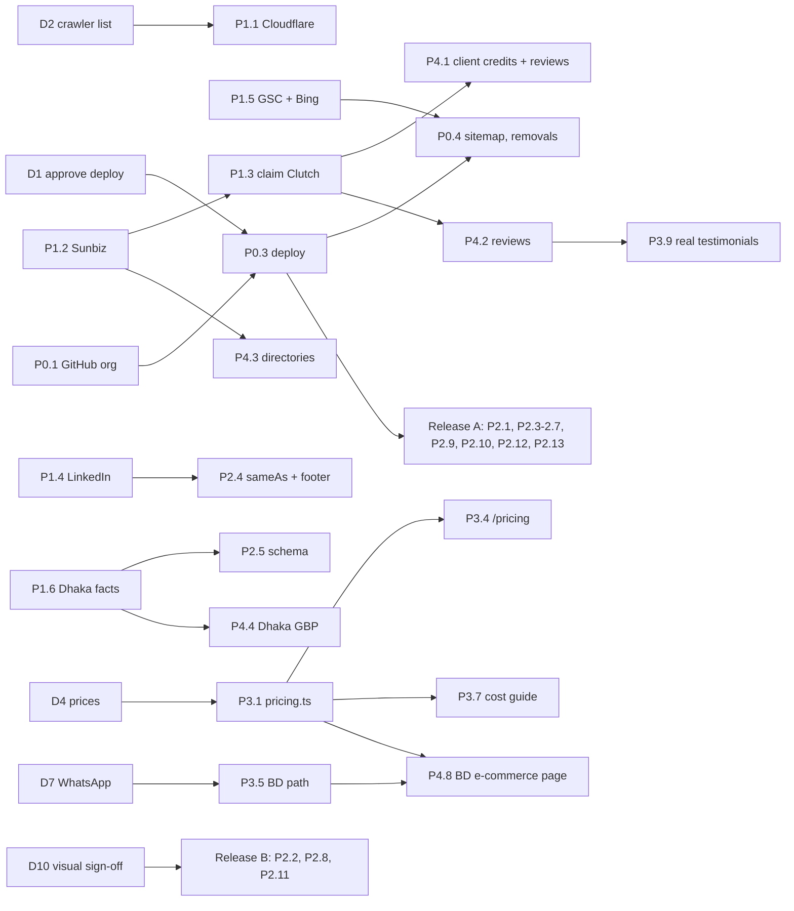

# Arrowbin fix plan (from the 14 October 2026 audit)

**Goal:** take arrowbin.com from **63 to about 85** on the SEO Health Score within 6 weeks, then to about 88 by month 6, while making the site recommendable by AI assistants and turning visits into tracked leads.

**Inputs:**
- `AUDIT-REPORT.md` and the 14 specialist reports in this folder
- the 12-month strategy in `../10-roadmap/seo-roadmap.md`
- the content plan in `../06-content-plan/`
- the keyword map in `../05-keyword-map/`

This plan replaces the "ACT" section of the 1 Oct audit. The 12-month roadmap still governs content and authority beyond week 6.

## How to read this plan

**Owner:**
- **dev:** code in this repo.
- **founder:** decisions, accounts, client relationships, facts only the founder has.

**Effort:** S = under 2 hours, M = half a day to 2 days, L = more than 2 days.

**◆ (needs visual sign-off):** the item could change how the site looks or moves. Build it, show it on the founder's dev server (`next dev` on :3001), get approval, then ship. Nothing changes visually without approval.

**Done means deployed and verified live.** An item counts only when its check passes against production: either a section of `verify-live.sh` or the stated signal. "Fixed locally" is not done. That is how the 1 Oct fixes sat unshipped for two weeks.

```bash
bash docs/seo/12-audit-2026-10-14/verify-live.sh                          # production
bash docs/seo/12-audit-2026-10-14/verify-live.sh http://localhost:3117    # local prod build
```

**Gate baseline today: live fails 34 checks, the local build fails 7.** Target: 0 by the end of Phase 2. The exceptions are the Cloudflare checks, which pass when P1.1 is done.

---

## Score path (projected)

| Category (weight) | Live now | After Phase 0 (deploy) | After Phases 1 and 2 | After Phase 3 | Month 6 |
|---|---|---|---|---|---|
| Technical (22) | 62 | 89 | 94 | 94 | 95 |
| Content (23) | 55 | 66 | 68 | 76 | 85 |
| On-page (20) | 68 | 82 | 86 | 88 | 90 |
| Schema (10) | 79 | 89 | 95 | 96 | 96 |
| Performance (10) | 62 | 66 | 80 | 80 | 85 |
| AI readiness (10) | 50 | 55 | 65 | 70 | 78 |
| Images (5) | 78 | 84 | 90 | 90 | 90 |
| **Total** | **63** | **76** | **82** | **85** | **88** |

**Assumptions:**
- Phase 3 assumes the founder supplies prices, proof decisions and a risk-reversal line. The placeholder testimonials stay (founder decision), so Content tops out near 76. Replacing them with real reviews adds about 2 points.
- Month 6 assumes reviews, profiles, two case studies and the Bangladesh e-commerce page are live.

---

## Decisions only the founder can make (blocking items in brackets)

| # | Decision | Recommended default | Blocks |
|---|---|---|---|
| D1 | Approve commit and deploy of the 7 local fix batches | Yes, today | Everything (P0) |
| D2 | Which AI crawlers to allow at Cloudflare | Allow GPTBot, ClaudeBot, CCBot, OAI-SearchBot, ChatGPT-User, Claude-SearchBot, Claude-User, PerplexityBot, Google-Extended, Applebot-Extended. Optional: Bytespider and Amazonbot | P1.1 |
| D3 | Florida LLC: reinstate, or present a different legal entity | Check Sunbiz first; reinstate if dissolved | P1.3, P4.3, every US listing |
| D4 | One price table (USD, and BDT for Bangladesh work) per service | Founder writes real ranges from past invoices | P3.1, P3.4, P2.9 (llms.txt facts), P3.7 |
| D5 | Proof for mobile / AI / SaaS / cloud / UI-UX pages: real projects (anonymised is fine) or honest relabel | Relabel now, swap in real work as it is approved | P3.2 |
| D6 | One risk-reversal promise you will always honour | "Leave after any sprint with all code and docs" and "30 days of post-launch fixes included" | P3.3 |
| D7 | WhatsApp business number for Bangladesh buyers | Use the Dhaka number if it is on WhatsApp Business | P3.5 |
| D8 | Dhaka office: full street address; staffed and visitable or not; real hours or none | If not visitable, publish no hours and no GBP | P2.5, P4.4 |
| D9 | Testimonials | Kept for now (your decision). Swap in real quotes as soon as the first reviews arrive | P3.9 |
| D10 | Approve motion and visual changes after seeing them on :3001 | Review in one sitting at the end of week 1 | P2.2, P2.8, P2.11 |

---

## Phase 0: ship what is already built (day 0 to 1)

| # | Action | Owner | Effort | Depends on | Done when |
|---|---|---|---|---|---|
| P0.1 | **Fix the GitHub org before deploy**. The new `sameAs` links to it. Set email hello@arrowbin.com, location "Dhaka, Bangladesh", the current one-line description (no "Digital Agency"), website https://arrowbin.com | founder | S | none | github.com/Arrowbin-LLC shows hello@ and the new description |
| P0.2 | **Pre-flight:** set `STATIC_BASELINE` in `src/app/sitemap.ts` to the deploy date. Then run `pnpm tsc --noEmit -p .`, `pnpm biome check` on changed files and `pnpm build`. Run `verify-live.sh http://localhost:3117`: only the 7 known OPEN checks may fail | dev | S | D1 | build passes; local gate shows only the 7 known items |
| P0.3 | **Commit, push and deploy** the 7 batches. Purge the Cloudflare cache for HTML | dev (founder approves) | S | P0.1, P0.2 | `verify-live.sh` sections 1, 2, 5 and 6 pass on production, except items scheduled in Phase 2 |
| P0.4 | **Tell search engines.** Resubmit `sitemap.xml` in Search Console and Bing. Request indexing for `/`, `/services` and the 8 service URLs. File **Removals** for `/products5070048.html` only (filed 17 Oct 2026; never for `?channel=` URLs: Search Console reads that prefix as the whole site and offers "Remove entire site?") | founder (GSC access) or dev | S | P0.3, P1.7 | GSC sitemap status "Success"; spam URLs gone from `site:arrowbin.com` within 30 days |

**Failure signal:** any 1 Oct item still failing in `verify-live.sh` after deploy, or a visual difference the founder did not approve. For the second, compare `screenshots/local-*.png` with fresh production screenshots.

---

## Phase 1: edge, entity and data (week 1, mostly founder)

| # | Action | Owner | Effort | Depends on | Done when |
|---|---|---|---|---|---|
| P1.1 | **Cloudflare:** allow the crawlers in D2 under AI Crawl Control / Bots. Then filter Security > Events by user agent to confirm real GPTBot and ClaudeBot hits are no longer blocked. Add one redirect rule: `http://www.arrowbin.com/*` straight to `https://arrowbin.com/$1` (one hop). Optional: a Cache Rule so HTML is served from the edge | founder | S | D2 | `verify-live.sh` section 7 all 200, section 8 all "1 hop" |
| P1.2 | **Sunbiz:** open search.sunbiz.org, document L24000209589. Record the status and dates; file the annual report and reinstatement if dissolved | founder | S to M | none | Sunbiz shows ACTIVE |
| P1.3 | **Claim Clutch** (clutch.co/profile/arrowbin-0): set Dhaka as the primary location, add "Ste 300" to the US mailing address, remove the Tampa wording, check that no duplicate profile exists. Send the URL to dev | founder | S | P1.2 (for US address) | profile claimed; URL added to `sameAs` (P2.4) |
| P1.4 | **LinkedIn company page** with the same name, description, NAP and website. Send the URL to dev | founder | S | none | page live; URL in `sameAs` and the footer (P2.4) |
| P1.5 | **Search Console** (domain property via a DNS TXT record in Cloudflare), Bing Webmaster Tools (import from GSC), Ahrefs Webmaster Tools (free). Record the month-0 baseline: indexed pages, impressions, referring domains | founder + dev | S | none | all three verified; baseline saved in `docs/seo/` |
| P1.6 | **Dhaka facts (D8):** send the full street address, whether the office is staffed and visitable, and real hours if any | founder | S | none | facts recorded; P2.5 and P4.4 unblocked |
| P1.7 | **GA4:** create an "AI assistants" channel group (chatgpt.com, perplexity.ai, gemini.google.com, copilot.microsoft.com, claude.ai). Mark `generate_lead` as a key event | dev (GA4 access from founder) | S | none | AI channel visible in GA4 reports |

---

## Phase 2: code sprint (weeks 1 to 2, dev; ◆ items need founder sign-off on :3001)

| # | Action | Files | Effort | Done when |
|---|---|---|---|---|
| P2.1 | **Unwrap the remaining Suspense boundaries** so FAQ, hub, capabilities, engagement and CTA text ship inside `<main>`. Measure home and service TBT as a median of 3 Lighthouse runs before and after. If TBT rises, split client components instead of restoring Suspense | `src/app/services/page.tsx` (5), `src/app/services/[slug]/page.tsx` (5), `src/app/about/page.tsx`, `src/app/blog/page.tsx`, `src/app/blog/[slug]/page.tsx` | S | `verify-live.sh` section 3 shows 0 hidden blocks on all five pages; /services `<main>` holds the FAQ |
| P2.2 ◆ | **One copy of each word for crawlers.** Manifesto: render the solid "fill" layer only after hydration (it is invisible at first paint anyway, since words start as outlines), so server HTML carries the outline text once. Do the same for the outline "ghost" layer in Numbers. Home H1: keep the sr-only sentence as the H1 text and move the animated letters out of the text flow. The visual result must be identical: **test on :3001**, not only the prod build. (The earlier CSS `attr()` attempt broke the fill effect on dev and was reverted) | `src/components/home/Manifesto.tsx`, `src/components/home/motion/ManifestoMotion.tsx`, `src/components/home/Numbers.tsx`, `src/components/home/Hero.tsx` | M | `verify-live.sh` section 4 passes; extracted H1 contains the tagline once; founder approves side-by-side video of before and after |
| P2.3 | **Metadata hygiene.** Remove `canonical` from the root layout `alternates` (keep the RSS `types`) and confirm every page sets `pageAlternates()`. One robots meta on the 404. og:url per page on /privacy and /terms. Titles "Privacy Policy: How Arrowbin Handles Your Data" and "Terms of Service for Arrowbin Projects". /terms description 140 to 155 chars. Add `og:image:alt` on service pages | `src/app/layout.tsx`, `src/app/not-found.tsx`, `src/app/privacy/page.tsx`, `src/app/terms/page.tsx` | S | `verify-live.sh` "404 page has no canonical" passes; og:url matches the page URL |
| P2.4 | **Social links.** Hide the footer LinkedIn link until P1.4 delivers the company URL. Then add LinkedIn and Clutch to `sameAs` and the footer | `src/lib/site.ts` | S | `verify-live.sh` "no placeholder LinkedIn" passes |
| P2.5 | **Schema remainder** (ready code in `schema.md`; founder fix in `page-home.md`). Fix the dangling `Organization.founder` reference: the `#founder` Person node is only emitted on /about and posts, so add a minimal Person node (name, url, jobTitle, sameAs) next to Organization sitewide. Dhaka node: drop `openingHoursSpecification` unless D8 confirms hours, and no neighbourhood as `streetAddress`. BlogPosting: `@id`, `mainEntityOfPage` object, author `jobTitle` + `worksFor`. Skip single-item BreadcrumbList. Named ItemLists with `@id`, reusing the Service `@id`s. CollectionPage name "Arrowbin Blog". WebSite `inLanguage: "en"` | `src/lib/schema.ts`, `src/lib/site.ts`, `src/app/blog/page.tsx` | S | Schema validator shows no hours on the Dhaka node, BlogPosting `@id` present, no one-item breadcrumb on `/` |
| P2.6 | **Title and intro keywords.** E-commerce "E-commerce Development Company for Online Stores \| Arrowbin". AI "AI Automation Agency for Small Businesses \| Arrowbin". UI/UX "UI/UX Design Agency for Web & Mobile Apps \| Arrowbin". Put the mapped head term in hero sentence one on all 8 service pages (copy only, founder reads it first). H1s stay as they are (visual). In the "What is …?" H2, stop swapping "-" for a non-breaking hyphen (U+2011), which breaks the "e-commerce" keyword match; wrap the name in a `whitespace-nowrap` span instead (looks identical) | `src/lib/services.ts`, `src/components/services/ServiceValue.tsx` | S | each title holds its mapped head term; no duplicate titles in the crawl |
| P2.7 | **Internal links and freshness.** Add contextual links from blog posts to the 6 services that get none (e-commerce, mobile, UI/UX, AI, cloud, maintenance). Add a mid-article CTA after the first table in the cost guide, and turn its in-text "book a call" sentence into a real link (today there is no CTA inside the article). Derive RSS `lastBuildDate` from the newest post | `src/lib/blog.ts`, `src/app/blog/[slug]/page.tsx`, `src/app/blog/rss.xml/route.ts` | S | every service page has at least one inbound link from `/blog/*` |
| P2.8 ◆ | **Mobile performance pass.** (a) Make the LCP hero paragraph visible at first paint and animate only transform. (b) Cut style and layout thrash: scope `text-wrap: balance`, stop animating the `wdth` variable axis on load, drop or shrink the `blur(48px)` and `backdrop-filter` layers on mobile, and avoid ScrollTrigger refresh reads after `fonts.ready`. (c) Service hero CLS (custom software 0.138, e-commerce 0.137; same font swap on every service hero): size-matched font fallback or reserved hero height. (d) Load GA on first interaction or idle with a cap. (e) Trim `globals.css` (34 KB) to what the first screen needs. (f) Run a bundle analyzer on the three heaviest chunks | `src/app/globals.css`, `src/components/home/motion/HeroMotion.tsx`, `src/components/motion/InnerMotion.tsx`, `src/components/motion/useGsapReveal.ts`, `src/components/motion/SmoothScroll.tsx`, `src/components/services/ServiceHero.tsx`, `src/app/layout.tsx`, `src/components/analytics/GoogleAnalytics.tsx` | M to L | Lighthouse mobile, median of 3: LCP at or under 2.5 s, TBT at or under 300 ms, CLS under 0.1 on /, one service page and /work; founder approves motion |
| P2.9 | **llms.txt rewrite.** Add a key-facts block: founder, founded 2020, services, timeline, plus price bands once D4 is in. Add hub links (/services, /work, /blog). Remove the office-first opening. Add the Cal.com booking and /contact brief links so agents can act. Keep wording consistent with the homepage title. Add a `Content-Signal` line (search=yes, ai-input=yes, ai-train per D2) to every robots group | `src/app/llms.txt/route.ts`, `src/app/robots.ts` | S | file contains founder, founding year and hub links; no "offices" in the first paragraph |
| P2.10 | **Lead tracking.** GA4 event on Cal.com link clicks, plus a confirmed-booking signal (Cal.com webhook to `/api` or a redirect-back thank-you page). Add a "How did you hear about us?" select to the contact brief and service quote form, with an "AI assistant (ChatGPT, Claude, Perplexity…)" option. Add a `web-vitals` INP reporter | `src/components/contact/*`, service quote form, `src/app/api/contact/route.ts`, `src/lib/email/templates.ts`, `GoogleAnalytics.tsx` | M | a test booking and a test brief both appear in GA4 DebugView; the notification email shows the source answer |
| P2.11 ◆ | **Visual polish batch.** `min-h-11` on the logo, email and CTA links still under 44px. Raise 10 to 11px labels to 12px on /work and service heroes. Alt text for the 5 /work screenshots and the /about founder photo. A proposal to lift the mobile homepage H1 (now at y=696 of 844). A "Start a project" link above the fold on /blog. Confirm whether the clipped right-hand card in the /work desktop deck is intended | `src/components/layout/Navbar.tsx`, `Logo.tsx`, `Footer.tsx`, `src/components/work/WorkDeck.tsx`, `src/components/services/ServiceHero.tsx`, `src/components/about/*`, `src/components/home/Hero.tsx`, `src/components/blog/BlogIndex.tsx` | M | no tap target under 44px in the Playwright check; founder approves screenshots |
| P2.12 | **i18n hygiene.** `dynamicParams = false` on the slug routes so unknown slugs return a real 404 with `lang`. `lang="bn"` on the Bangla project name. `og:locale` on every page | `src/app/services/[slug]/page.tsx`, `src/app/blog/[slug]/page.tsx`, `src/lib/portfolio.ts` usage, `src/app/layout.tsx` | S | `/services/nope` returns 404 with `<html lang="en">` |
| P2.13 | **Agent and form hygiene** (`agentic.md` A-5 to A-11). Expose required fields as `required`/`aria-required` on /contact. Announce quote-form success with `role="status"` and move focus to it. Give the chip group a proper accessible name. Rename the honeypot so it does not look like a real field (agents fill `company_website` and the lead is silently dropped). Add `/.well-known/security.txt`. Optional later: `llms-full.txt` and Markdown delivery | `src/components/contact/*`, service quote form, `src/app/api/contact/route.ts`, `public/.well-known/` | S | Lighthouse agentic 3/3 on every template; a DOM agent can submit the brief and the lead arrives |

Ship Phase 2 in two releases:
- **Release A (no visual change):** P2.1, P2.3 to P2.7, P2.9, P2.10, P2.12, P2.13.
- **Release B (after sign-off):** P2.2, P2.8, P2.11.

Run `verify-live.sh` after each release.

---

## Phase 3: trust, price and proof (weeks 1 to 4; founder facts, then dev)

| # | Action | Owner | Effort | Depends on | Done when |
|---|---|---|---|---|---|
| P3.1 | **One price source of truth.** `src/lib/pricing.ts` feeds every FAQ, the FAQ JSON-LD, service pages, llms.txt and later /pricing. Cover all 8 services, including e-commerce (Shopify / headless / custom), SaaS MVP and maintenance per month. Show USD, plus BDT where relevant. In the cost guide, label market ranges as market data and Arrowbin's own ranges as Arrowbin's | founder (numbers), dev | M | D4 | grep finds one floor per service across the site; e-commerce, SaaS and maintenance show a price |
| P3.2 | **Proof that matches the service.** Use real mobile, AI or SaaS work where it exists (anonymised: client type, what shipped, year). Otherwise relabel the headings honestly (for example "Related web work") and lead with the interactive demos as capability proof. Never use a heading that promises app, AI or SaaS proof that does not exist. E-commerce page: show all 6 commerce builds (it shows 3), and either add a Shopify example or stop leading with Shopify as the first recommendation (no Shopify store is in the portfolio; see `page-ecommerce.md`) | founder, dev | M | D5 | no service page shows unrelated work under a service-specific heading |
| P3.3 | **Risk reversal:** one honoured line beside every hero form and in the closing CTA | founder, dev | S | D6 | line present on the homepage and all 8 service pages |
| P3.4 | **/pricing page plus ungated calculator**, with an optional "email me the breakdown" capture that pre-fills the quote form. Offer schema per tier | dev | L | P3.1 | /pricing returns 200 and is in the sitemap; calculator emits a GA4 event |
| P3.5 | **Bangladesh buyer path:** WhatsApp click-to-chat on /contact, the e-commerce page and the future Bangladesh page. BDT bands. A lower budget chip on /contact ("Under ৳3 lakh" or equivalent) | founder (number), dev | S | D7, P3.1 | `wa.me` link present on those pages; WhatsApp click event in GA4 |
| P3.6 | **De-duplicate the service pages.** Tailor "Three ways to start", the process subtitle and the closing CTA text per service (target: under 25% shared lines). Trim AI-typical words ("actually" 31, "Here's" 16, "honest" 12). Align "software studio" with "software development company" in visible copy | founder approves copy, dev | M | none | boilerplate share under 25% on each service page (method in `content.md` M-8) |
| P3.7 | **Cost guide refresh.** Real "Updated" date. Label "A real example" as a representative example (or use a real anonymised project). Source the rate table or label it "Arrowbin estimate". Add a Bangladesh/BDT paragraph and a "what Arrowbin projects cost" box from P3.1 | founder, dev | M | P3.1 | date is current; every rate figure has a source or an "estimate" label |
| P3.8 | **Verify or soften claims:** "15+ brands … fintech and media", "Online ordering live in 8 weeks", "all 64 districts", "senior engineers" | founder | S | none | every claim is confirmed in writing or reworded |
| P3.9 | **Testimonials.** Keep for now (D9). Swap each placeholder for a real quote with written consent as reviews arrive. Never add Review or AggregateRating markup for them | founder, dev | S | P4.2 | no placeholder name on the site (target: by week 6) |
| P3.10 | **Founder authority:** byline plus a short "why I wrote this" box on each guide. Expand the /about founder section (years, stack, links to LinkedIn and GitHub) | founder (text), dev | S | P1.4 | every post shows the byline box |
| P3.11 ◆ | **Section expansions from the page analyses** (static sections in the existing style; each new block needs sign-off). Home (`page-home.md`): "Who we build for", an "Agency, freelancer or in-house?" comparison table, a "Guides before you hire" block linking the cost, how-to-choose and MVP posts, and the founder's name and founding year in visible copy. Custom software (`page-custom-software.md`): a CRM / ERP / business-systems section (`#crm-erp`), a cost section fed by P3.1, "Industries we have built for" (proof-backed only), "Who builds your software", named security practices, descriptive internal anchors. E-commerce and the cost guide: see `page-ecommerce.md` and `page-cost-post.md` | founder (approval), dev | L | P3.1, P3.2 | each page carries the new sections; homepage links to all 3 guides from `<main>` |

---

## Phase 4: authority, local and links (weeks 2 to 12)

| # | Action | Owner | Effort | Depends on | Done when |
|---|---|---|---|---|---|
| P4.1 | **One message per client** covering a footer credit ("Designed & built by Arrowbin LLC", followed link), a short quote and a Clutch review. Send to silentlifestylebd.com, flexoverbd.com, gtegoyna.com.bd, ytshopindia.com and outnet.it.com. For brandingly.agency, replace the HTML comment with a visible link. If you maintain their code, add the credit yourself with their OK | founder | S each | P1.3 | 6 or more followed referring domains in Ahrefs WMT or GSC Links by week 6 |
| P4.2 | **Reviews:** ask 5 to 10 past clients for verified Clutch reviews (no incentives). Use Google reviews too if P4.4 happens | founder | M | P1.3 | 3 reviews by week 6, 7 by day 90 |
| P4.3 | **Directories** with identical NAP and description: GoodFirms, DesignRush, Crunchbase (company and founder), TechBehemoths, The Manifest, Hostinger Agency Directory. Add each URL to `sameAs` as it goes live | founder, dev | M | P1.2, P0.1 | 6 or more live profiles by day 30 |
| P4.4 | **Dhaka Google Business Profile**, only if the office is staffed and visitable (D8). No US GBP at the virtual office | founder | M | P1.6 | GBP verified; NAP matches the site |
| P4.5 | **Two case studies** at `/work/<slug>` (for example Silent Lifestyle BD and North Bengal Agro Farms), each with client approval: problem, approach, what shipped, timeline, a confirmed outcome | founder (approval), dev | L | P4.1 | 2 pages live, linked from /work and the matching service pages |
| P4.6 | **GitHub:** publish 1 or 2 useful public repos (for example Next.js helpers for bKash, Nagad and SSLCommerz) with READMEs that link back | dev | M | P0.1 | repos public; org shows more than 0 repos |
| P4.7 | **Hostinger:** ask for an inbound partner-page link and a directory listing | founder | S | none | link live |
| P4.8 | **Bangladesh e-commerce page** (`/ecommerce-website-development-bangladesh`) **before the Tampa page**. Real proof exists for it. Then a Bangla version using the ready `bn-BD` hreflang set in `hreflang.md` §4 | dev, founder (copy check) | L | P3.1, P3.5 | page indexed; ranks for "ecommerce website development bangladesh" within 90 days |
| P4.9 | **Tampa Bay page:** areaServed only, no street address, honest about the remote team | dev | M | P4.8, P1.2 | page live; no LocalBusiness node for St. Pete |
| P4.10 | **PR and founder voice:** LinkedIn posting rhythm (one useful post a week). Journalist requests (Qwoted etc.). Pitch the cost and MVP guides to Bangladeshi tech press and "best agencies" listicles | founder | ongoing | P1.4 | 2 or more unlinked or linked brand mentions per month |

---

## Phase 5: content programme (months 2 to 6)

Follow `../06-content-plan/content-plan.md` and roadmap Phases 2 and 3 in `../10-roadmap/seo-roadmap.md`, with these changes from this audit:
- **Order:** Bangladesh e-commerce (P4.8) before Tampa. /pricing (P3.4) before the MVP service page.
- **Rewrites:** add the five citable rewrites in `geo.md` §8 (homepage entity block, mobile short answer, e-commerce comparison, SaaS timeline FAQ, hosting fact) once D4 numbers exist.
- **Prompt tracking:** add a prompt-to-page column to `../07-geo-aeo/ai-prompt-tracking.csv`, and re-run the 40-prompt test monthly.
- **Re-audits:** re-run this audit at day 30 and day 90 against the same `verify-live.sh` and score table.

---

## Dependencies



---

## Timeline at a glance

| When | Founder | Dev |
|---|---|---|
| Day 0 to 1 | D1, P0.1, D2 + P1.1, P1.2 (about 1 hour) | P0.2, P0.3, P0.4 |
| Week 1 | P1.3, P1.4, P1.5, P1.6, D4 to D8 facts | Release A (P2.1, P2.3 to P2.7, P2.9, P2.10, P2.12, P2.13), P1.7 |
| End of week 1 | D10: review P2.2, P2.8, P2.11 on :3001 | build P2.2, P2.8, P2.11 for review |
| Week 2 | P4.1 messages out, P4.3 profiles started | Release B; P3.1, P3.2, P3.3, P3.5 once facts arrive |
| Weeks 3 to 4 | P3.8, P3.10 text, P4.2 follow-ups | P3.4 /pricing, P3.6, P3.7 |
| Weeks 5 to 12 | P4.4, P4.5 approvals, P4.7, P4.10 | P4.5, P4.6, P4.8, then P4.9; Phase 5 content |

**Effort estimate:**
- **Dev:** Phase 0 about 2 hours, Phase 2 about 5 to 7 days, Phase 3 about 4 to 5 days once facts exist, Phase 4 builds about 6 to 8 days.
- **Founder:** about 1 hour on day 0, 3 to 4 hours in week 1, then about 1 to 2 hours a week of outreach and approvals.

---

## KPIs and targets

| KPI | Baseline (14 Oct) | Day 30 | Day 90 | Day 180 | Source |
|---|---|---|---|---|---|
| `verify-live.sh` failures | 34 | 0 | 0 | 0 | script |
| SEO Health Score (this method) | 63 | 82 | 85 | 88 | re-audit |
| AI crawlers returning 200 (7 official UAs) | 4 of 7 | 7 of 7 | 7 of 7 | 7 of 7 | script §7 |
| Home mobile LCP (lab, median of 3) | 3.86 s | 2.5 s or less | 2.5 s or less | 2.5 s or less (field p75 when CrUX exists) | Lighthouse / GSC CWV |
| Indexed pages | unknown | 19 | 25+ | 35+ | GSC |
| Primary keywords in top 10 (US + BD) | 0 | 2 long-tail | 10 | 40 | GSC |
| Followed referring domains | 2 | 8 | 12 | 20 to 30 | Ahrefs WMT / GSC Links |
| Clutch reviews | 0 | 3 | 7 | 10+ | Clutch |
| Live entity / directory profiles | 1 (unclaimed Clutch) | 6 | 10 | 12 | manual |
| AI mentions (40-prompt tracker) | 0 of 20 | 0 to 1 | 2 | 8 | `../07-geo-aeo` tracker |
| Tracked leads (briefs + bookings) from organic/AI | not tracked | tracked | 3 a month | 8 a month | GA4 key events |
| SXO persona averages (US founder / SMB / BD owner) | 64.9 / 67.3 / 58.3 | 68 / 70 / 64 | 72 / 74 / 70 | 75 / 76 / 74 | re-run SXO |

## Leading indicators (weekly, no re-audit needed)

- `verify-live.sh` exit code (0 = healthy)
- GSC: indexed pages, impressions for the 12 primary keywords, Removals status
- Cloudflare Security > Events: no blocks on allowed AI crawlers
- GA4: `generate_lead`, booking events, the "AI assistants" channel, the "How did you hear" answers
- Clutch review count; new referring domains in Ahrefs WMT

## Failure checks (when to change course)

- Any `verify-live.sh` failure after a release: stop and fix before the next item.
- GSC shows fewer than 15 of 19 pages indexed by day 30: inspect coverage reasons before adding content.
- No `generate_lead` or booking events in GA4 within 14 days of P2.10: tracking is broken, fix before judging conversion.
- Fewer than 3 reviews by week 6: change the ask (a personal call, a pre-filled Clutch interview slot).
- Mobile LCP still above 2.5 s after P2.8: profile again and consider dropping the hero WebGL canvas on mobile (◆, founder decision).
- AI mentions still 0 at day 90 with crawlers allowed: authority is the gap (P4.3, P4.10), not on-page.

## Risks

| Risk | Mitigation |
|---|---|
| A deploy changes the look of the site unintentionally | Release A changes no visuals; Release B only after sign-off on :3001. Compare screenshots before and after each release |
| Motion and performance changes break an effect on `next dev` but not on the prod build (it happened once) | Test every ◆ item on the founder's dev server and the prod build before showing it |
| Allowing AI crawlers raises bot load | Cloudflare rate limiting per user agent; watch Security > Events in week 1 |
| LLC dissolved | Pause US-entity listings until reinstated; list Dhaka as primary on directories meanwhile |
| Placeholder testimonials (FTC 16 CFR 465) | Founder decision noted; replace with real quotes as reviews arrive (P3.9) |
| Published prices become commitments | Publish ranges with "typical" wording and what drives cost; keep the fixed quote after discovery |

---

## Related plan documents (not duplicated here)

| Need | File |
|---|---|
| Strategy, phases beyond week 6, KPIs to month 12 | `../10-roadmap/seo-roadmap.md` |
| Competitor analysis | `../02-competitors/gap-analysis.md`, `../02-competitors/competitor-list.csv` |
| Site structure and target pages | `../05-keyword-map/keyword-map.md`, `page-targets.csv` |
| Content calendar and page templates | `../06-content-plan/content-plan.md` |
| GEO playbook and prompt tracker | `../07-geo-aeo/geo-aeo-playbook.md` |
| Local and link plans | `../08-local/local-seo-plan.md`, `../09-links/link-building-plan.md` |
